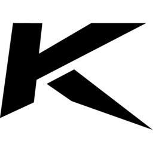
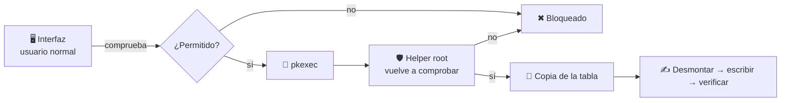

<div align="center">



# KORVEX Disk Manager

**Gestor de discos para Windows y Linux.**
Particiones, clonado, imágenes, USB arrancables y diagnóstico de discos,<br>
con el disco del sistema siempre protegido.

[](../../releases/latest)
[](#-instalación)
[](#-instalación)
[](https://pypi.org/project/PyQt6/)
[](LICENSE)

[**Descargar**](../../releases/latest) · [Instalación](#-instalación) · [Uso](#-uso) · [Seguridad](#%EF%B8%8F-seguridad) · [Problemas](#-problemas-frecuentes)

</div>

---

## ✨ Características

<table>
<tr>
<td width="50%" valign="top">

### 💽 Particiones
- **Mapa visual** de cada disco, a escala, con uso y espacio libre
- **Formatear**: ext4 (Linux), NTFS, exFAT, FAT32
- **Crear, eliminar y redimensionar** particiones
- **Cambiar letra** (Windows) y **etiqueta**
- **Convertir formato**: FAT32 → NTFS sin perder datos (Windows)
- **Comprobar y reparar** el sistema de archivos
- **Montar / desmontar** (Linux)

</td>
<td width="50%" valign="top">

### 🧬 Disco completo
- **Clonar** sector a sector, con verificación SHA-256
- **Crear imagen** `.img` y **restaurarla**
- **USB arrancable** desde una ISO (avisa si la ISO no arrancará)
- **Inicializar** con tabla GPT o MBR
- **Borrado seguro**: ceros, aleatorio o TRIM completo (SSD)

</td>
</tr>
<tr>
<td width="50%" valign="top">

### 🩺 Diagnóstico
- **Salud SMART**: temperatura, horas, sectores reasignados, desgaste del SSD
- **Test de velocidad**: lectura secuencial y aleatoria 4K (solo lectura)
- **Escaneo de superficie**: busca sectores defectuosos (solo lectura)

</td>
<td width="50%" valign="top">

### 🛡️ Segura
- El disco del sistema **nunca** se modifica
- **No se puede cerrar** durante una operación, y se impide apagar/suspender
- Avisa al reabrir si una operación quedó **interrumpida**
- Interfaz oscura en **PyQt6**, a juego con KORVEX Audio Console

</td>
</tr>
</table>

---

## 📥 Instalación

### 🐧 Debian / Ubuntu (recomendado)

Descarga el `.deb` desde [**Releases**](../../releases/latest) e instálalo:

```bash
sudo apt install ./korvex-disk-manager_1.0.0_all.deb
```

Aparece en el menú de aplicaciones como **KORVEX Disk Manager** y `apt` instala todas las dependencias.

> [!TIP]
> Usa `apt install ./archivo.deb` (con el `./`) en lugar de `dpkg -i`, así `apt` resuelve las dependencias por ti.

<details>
<summary><b>Otras distribuciones (Arch, Fedora, openSUSE…)</b></summary>

<br>

```bash
git clone https://github.com/mikicolmena/KORVEX-Disk-Manager.git
cd KORVEX-Disk-Manager
pip3 install --user -r requirements.txt
python3 main.py
```

Necesitas además `lsblk` (util-linux), `pkexec` (polkit) y las herramientas `mkfs` de los formatos que quieras usar: `e2fsprogs`, `ntfs-3g`, `exfatprogs`, `dosfstools`.

</details>

### 🪟 Windows

Descarga `KORVEX-Disk-Manager.exe` desde [**Releases**](../../releases/latest) y ábrelo. Windows pedirá permisos de administrador (UAC): son necesarios para leer los discos físicos, formatear y clonar.

<details>
<summary><b>Desde el código fuente</b></summary>

<br>

```bat
git clone https://github.com/mikicolmena/KORVEX-Disk-Manager.git
cd KORVEX-Disk-Manager
pip install -r requirements.txt
python main.py
```

</details>

<details>
<summary><b>Construir los paquetes tú mismo</b></summary>

<br>

**Linux (.deb):**
```bash
./build_deb.sh
sudo apt install ./korvex-disk-manager_1.0.0_all.deb
```

**Windows (.exe):** en una consola dentro de la carpeta del proyecto
```bat
build_windows.bat
```
El ejecutable queda en `dist\KORVEX-Disk-Manager.exe`.

</details>

### 📋 Requisitos

| Componente | Versión | Para qué |
|:--|:--|:--|
| Python | ≥ 3.10 | |
| PyQt6 | ≥ 6.4 | Interfaz |
| **Windows:** PowerShell 5.1+ | — | Lectura de discos, formateo (módulo Storage) |
| **Linux:** `lsblk` | util-linux | Lectura de discos |
| **Linux:** `pkexec` | polkit | Permisos para formatear y clonar |
| **Linux:** `mkfs.*` | e2fsprogs, ntfs-3g, exfatprogs, dosfstools | Formateo |
| **Linux:** `sfdisk` | fdisk / util-linux | Crear, eliminar y redimensionar particiones |
| **Linux:** `smartctl` | smartmontools | Salud SMART |
| **Linux:** `udisksctl` | udisks2 (opcional) | Montar y desmontar |
| **Windows:** `smartctl` | smartmontools (opcional) | Atributos SMART completos (sin él se usan los contadores de Windows) |

---

## 🚀 Uso

| Sección | Qué puedes hacer |
|:--|:--|
| 💽 **Discos** | Mapa de cada disco. **Pulsa una partición** para abrirla, montarla, cambiar su letra o etiqueta, comprobarla, formatearla, convertirla, redimensionarla o eliminarla. **Pulsa un espacio libre** para crear una partición. El botón **🧰 Herramientas** de cada disco abre sus utilidades. |
| 📁 **Volúmenes** | Tabla con todos los volúmenes, su formato y espacio libre. Doble clic para abrir. |
| 🧬 **Clonar** | Elige origen y destino, revisa el resumen y pulsa **Clonar**. |
| 🧰 **Herramientas** | Salud SMART, test de velocidad, escaneo de superficie, imágenes, USB arrancable, inicializar y borrado seguro. |
| ⚙️ **Ajustes** | Comportamiento al cerrar, protecciones activas y carpeta de logs. |

Mientras se ejecuta una operación aparece una barra de progreso arriba con velocidad, tiempo restante, detalles y, si se puede interrumpir sin peligro, un botón **Cancelar**.

> [!NOTE]
> En Linux la app funciona como **usuario normal**. Pide tu contraseña (pkexec) cada vez que una operación necesita acceso al disco.

---

## 🛡️ Seguridad

Muchas de estas operaciones **borran datos**. Por eso KORVEX Disk Manager aplica varias capas de protección:

| Protección | Detalle |
|:--|:--|
| 🔒 **Disco del sistema** | Nunca se formatea, no se tocan sus particiones, no se inicializa, no se borra y no puede ser **destino**. En Linux se detecta por sus montajes (`/`, `/boot`, `/home`, swap…) y, de forma independiente, siguiendo el sistema raíz en sysfs (también con LVM/LUKS/RAID). En Windows, por los indicadores de arranque/sistema, la unidad de Windows y el archivo de paginación. Sí puede ser **origen** de una copia (solo se lee). |
| 🔒 **Particiones especiales** | EFI, reservadas, recuperación y swap no se tocan. A las particiones del sistema no se les cambia ni la letra ni la etiqueta. |
| 📄 **fstab** (Linux) | No se formatea, borra ni reetiqueta nada que esté en `/etc/fstab`: el equipo podría no arrancar. |
| ✅ **Doble validación** | La interfaz comprueba todo, y justo antes de escribir se vuelve a leer el estado de los discos. En Linux lo hace además el propio proceso de root, sin fiarse de la interfaz. |
| ⌨️ **Confirmación escrita** | Formatear, eliminar, redimensionar, inicializar, borrar, clonar y restaurar piden escribir el nombre del disco o de la partición. |
| 📏 **Tamaños** | El destino debe ser igual o mayor que el origen o la imagen. Si los tamaños cambian entre la selección y la operación (alguien desconectó algo), se aborta. |
| ⏏️ **Uso exclusivo** | Linux: se desmonta lo necesario y el disco se abre en **modo exclusivo** (si algo lo usa, se aborta). Windows: el disco se pone **offline** durante la escritura. |
| 🔎 **Verificación** | Clonar, imágenes, ISO y borrado releen y comparan con SHA-256. Antes de restaurar, la imagen se comprueba con su `.sha256`. |
| 💾 **Copia de la tabla** (Linux) | Antes de cambiar una tabla de particiones se guarda en `/var/lib/korvex-disk-manager/partition-tables`. |
| 🛑 **Sin cierres a medias** | Durante una operación la **X** y «Salir» de la bandeja no cierran la app. **Alt+F4** muestra una confirmación: las operaciones que se pueden interrumpir se cancelan de forma controlada; las que no (formatear, redimensionar, tablas de particiones…) obligan a esperar. En Linux la X también muestra esa confirmación, porque no se puede distinguir de Alt+F4. |
| 🔋 **Sin apagados** | Mientras se escribe se bloquea el apagado y la suspensión (systemd-inhibit / Windows). |
| 📝 **Registro de operaciones** | Si la app se cierra a la fuerza (administrador de tareas, corte de luz), al reabrirla avisa de qué quedó a medias. En Windows ofrece volver a poner online el disco. En Linux, las operaciones que no se pueden interrumpir **terminan igualmente** aunque la interfaz muera. |
| 1️⃣ **Una sola instancia** | No se pueden abrir dos ventanas que lancen operaciones a la vez. |



> [!WARNING]
> - Clonar el disco del sistema **mientras está en uso** puede dar una copia no del todo consistente si hay escrituras durante el proceso. Cierra programas antes de empezar.
> - Tras clonar, ambos discos tienen los **mismos identificadores**. En Windows, el destino puede quedarse offline por «colisión de firma»; en Linux, tener los dos conectados a la vez puede confundir el arranque.

---

## 🐛 Problemas frecuentes

<details>
<summary><b>Linux: «Autenticación cancelada o denegada»</b></summary>
<br>
Se cerró la ventana de contraseña o tu usuario no es administrador. Comprueba que tienes <code>pkexec</code> y un agente de polkit (lo incluyen GNOME, KDE, XFCE…).
</details>

<details>
<summary><b>Linux: no aparece algún sistema de archivos al formatear</b></summary>
<br>
Solo se ofrecen los que tienen su herramienta instalada: <code>sudo apt install e2fsprogs ntfs-3g exfatprogs dosfstools</code>
</details>

<details>
<summary><b>«No se pudo desmontar…» o «sigue en uso»</b></summary>
<br>
Algún programa tiene archivos abiertos en esa unidad (un explorador, una terminal dentro de la carpeta…). Ciérralo e inténtalo de nuevo. Si el disco tiene LVM, LUKS o RAID activos, desactívalos antes manualmente.
</details>

<details>
<summary><b>Windows: «se está ejecutando sin permisos de administrador»</b></summary>
<br>
Se rechazó el aviso de UAC. Vuelve a abrir la app y acepta el aviso para poder formatear y clonar.
</details>

<details>
<summary><b>Algo raro pasa y quiero ver qué ocurre</b></summary>
<br>
Abre <b>⚙️ Ajustes → Abrir carpeta de logs</b>. Rutas:<br>
• Linux: <code>~/.local/state/korvex-disk-manager/logs</code><br>
• Windows: <code>%LOCALAPPDATA%\KORVEX Disk Manager\logs</code>
</details>

---

## 📂 Estructura

```
KORVEX-Disk-Manager/
├── main.py                  # Punto de entrada (UAC, logs, instancia única)
├── ui.py                    # Interfaz: páginas, menús, diálogos y protección de cierre
├── style.py                 # Paleta y hoja de estilos KORVEX
├── operations.py            # Catálogo de operaciones y worker común (Qt)
├── disks.py                 # Lectura de discos (PowerShell / lsblk) y reglas de protección
├── rawio.py                 # Copia, verificación, borrado, escaneo y test bloque a bloque
├── diag.py                  # SMART y comprobación de sistemas de archivos
├── win_ops.py               # Windows: implementación de cada operación
├── korvex_helper.py         # Linux: proceso root lanzado con pkexec
├── helper_client.py         # Linux: comunicación con el helper
├── platform_utils.py        # Rutas, permisos, registro de operaciones, bloqueo de apagado
├── build_deb.sh             # Genera el paquete .deb
├── build_windows.bat        # Genera el .exe con PyInstaller
├── korvex-disk-manager.spec # Configuración de PyInstaller
└── KorvexLogo-*.png / .ico  # Iconos
```

La configuración se guarda en `~/.config/korvex-disk-manager/config.ini` (Linux) o `%APPDATA%\KORVEX Disk Manager\config.ini` (Windows). En Linux, las operaciones de root se registran en `/var/log/korvex-disk-manager.log`.

---

## 🤝 Contribuir

¡Las contribuciones son bienvenidas! Para cambios grandes, abre antes un [issue](../../issues) y lo hablamos.

```bash
git checkout -b feature/mi-mejora
git commit -m "feat: descripción"
git push origin feature/mi-mejora
```

…y abre un **Pull Request**.

---

<div align="center">

Parte del ecosistema **KORVEX** · Licencia [MIT](LICENSE)

Hecho con ❤️ por [@mikicolmena](https://github.com/mikicolmena)

</div>
